# CRTC2026 中期考核技术文档

> 队伍名称：随缘
> 队长：张川
> 队员分工：张川:电控；周鑫锐：视觉+电控；高俊杰：机械；罗小月：硬件+电控
> 实训战队：GSing
> 仓库地址：https://github.com/koreyoshi-zzz/CRTC2026-SuiYuan


## 一、项目概述

### 1.1 考核指标对照表

| # | 指标 | 手册要求（V1.6） | 本队状态 | 对应板块 |
| -- | ---- | ---- | ---- | ---- |
| 1 | 外形展示 | 至少一台携带能量单元的完整机器人机体，绕车一周展示 | 已实现（视频 `appearance_360.mp4`） | 5.1 |
| 2 | 电机运动（单一） | 至少一个电机转动 | 已完成 | 5.2 |
| 3 | 电机运动（全部） | 不少于 4 个电机转动 | 已完成 | 5.3 |
| 4 | 舵机运动（单一） | 至少一个舵机转动 | 已完成（视频 `servo_demo.mp4`） | 5.4 |
| 5 | 舵机运动（多项） | 同一台机器人 ≥3 个舵机转动，且可动机构在任意非初始状态保持相对静止 | 已完成（视频 `servo_demo.mp4`） | 5.5 |
| 6 | 底盘运动（单一） | PS2 手柄控制至少一个底盘的水平运动 | 已完成（视频 `chassis_ps2.mp4`） | 5.6 |
| 7 | 底盘运动（全部） | PS2 手柄控制全部车体的水平运动 | 未完成 | 5.7 |
| 8 | 尺寸规范 | 尺寸在规则限制内，需展示直尺等测量工具的测量结果 | 已完成（180×165×155 mm，照片 `dim_*.jpg`） | 5.8 |
| 9 | 方块携带（单一） | 自主使地面静止的 30×30×30 mm 方块由非携带态变为携带态 | 未完成 | 5.9 |
| 10 | 方块携带（多项） | 保持携带状态下再使至少一块方块变为携带态 | 未完成 | 5.10 |
| 11 | 结构稳定性 | 从 180 mm 高处底面朝下自由下落，无零件掉出 | 已完成（视频 `drop_test.mp4`） | 5.11 |
| 12 | 规划 / 现有采购单 | 核心部件选型、整机成本预算 | 已完成 | 5.12 |

>


### 1.2 开发时间线

本队小车开发历程如下：

| 序号 | 时间 | 阶段 | 产出 | 对应板块 |
| -- | ---- | ---- | ---- | ---- |
| 1 | 9.20 | 手册研读与需求拆解 | 12 项基础功能指标拆解为 6 个技术子系统 | 1.1 |
| 2 | 9.22 | 底盘选型与运动学方案 | 四轮麦轮选型对比结论 | 2.1 |
| 3 | 9.28 | 机械件建模与加工 | 机架、麦轮支架 | 2.3 |
| 4 | 10.8 | 电机驱动调试 | 单电机 → 四电机 | 5.2、5.3 |
| 5 | 10.11 | 硬件选型与底板设计 | 集成底板原理图 / PCB | 3.1、3.2、3.4 |
| 6 | 10.12 | PS2 手柄通信 | 软件模拟 SPI 驱动 | 5.6 |
| 7 | 10.14 | 舵机驱动调试 | 单舵机 → 三舵机 | 5.4、5.5 |
| 8 | 10.15 | 固件工程整合与联调 | 程序调试成功 | 4.1–4.4 |
| 9 | 10.16 | 尺寸实测与跌落测试 | 尺寸数据 + 跌落视频（重量待测） | 2.2、2.5、5.11 |
| 10 | 10.17 | pcb完成最终定稿 | 原理图与布线图（实物未到） | 5.13 |
| 11 | 10.18 | 方块携带机构方案设计 | 方案完成，实物未产出（3D 打印工期长） | 5.9、5.10 |


### 1.3 整体系统方案

系统自下而上分为四层：

- **电源层**：18650×2 串联（2S，标称 7.4 V）→ XT30 输入 → 自恢复保险丝 F1 → 双路 miniDC-DC 降压，分别输出 `+5V-STM32`（主控与 PS2）与 `+5V-SERVO`（舵机）；电机直接使用电池组电压；
- **驱动层**：2 片 DRV8833 双 H 桥驱动 4 个 TT 电机，TIM1/TIM2 共 8 路 PWM；TIM4 三路 PWM（50 Hz）驱动 3 个舵机；
- **控制层**：STM32F103C8T6 最小系统板，以插拔方式安装在集成底板上，损坏可整板更换；
- **遥控层**：PS2 无线手柄 + 接收器，4 根 GPIO 软件模拟 SPI；
- **安全层**：官方无线继电器串入电池回路，实现 10 m 遥控断电；PB5 为固件预留控制引脚。
- **机械层**：包括麦轮底盘、金属折弯机架、舵机执行机构与电池 / 电路板固定结构。

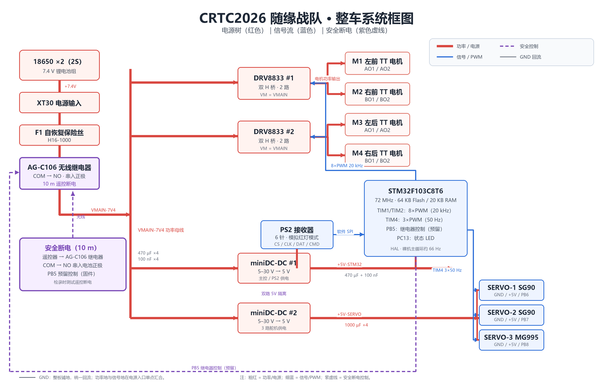

> 图注：红色粗线为功率/电源链（电池 → XT30 → 保险丝 → 无线继电器 → VMAIN → 双电机驱动 / 双路降压）；蓝色细线为信号/PWM（PS2 → STM32 → 驱动 / 舵机）；紫色虚线为安全断电控制（遥控器 → 继电器、PB5 预留控制）。


### 1.4 BOM 成本预算

**A. 计入机器人造价的部件**

| 器件名称 | 型号 / 款式 | 数量 | 单价(元) | 小计(元) | 来源 | 用途 |
| ---- | ---- | ---- | ---- | ---- | ---- | ---- |
| STM32 主控 | STM32F103C8T6 核心板 | 1 | 9.40 | 9.40 | 官方表① | 主控单元 |
| TT 电机 | 单轴 1:48 减速电机 | 4 | 2.83 | 11.32 | 官方表⑤ | 底盘动力 |
| 麦轮 | 60 mm 麦轮一套 4 个 + 联轴器 | 1 套 | 35.00 | 35.00 | 官方表⑥ | 全向移动 |
| 底盘 | 4 轮金属底盘折弯板 | 1 | 11.20 | 11.20 | 官方表⑦ | 承载结构 |
| 电机驱动 | DRV8833 双 H 桥模块 | 2 | 2.27 | 4.54 | 官方表⑨ | 4 路电机驱动 |
| 舵机 | SG90（180°） | 2 | 5.90 | 11.80 | 官方表③ | 执行机构 |
| 舵机 | MG995（180°，金属齿轮） | 1 | 14.50 | 14.50 | 官方表② | 执行机构 |
| PS2 手柄 | 无线手柄锁定款 + 直插转接板 | 1 | 45.00 | 45.00 | 官方表④ | 遥控输入 |
| 降压模块 | Mini 5 V 降压模块 | 2 | 2.09 | 4.18 | 官方表⑩ | 主控 / 舵机 5 V |
| 电池组 | 2×18650 + 电池盒 + 充电器 | 1 套 | 17.78 | 17.78 | 自购 | 电源供电 |
| 自恢复保险丝 | H16-1000 | 1 | 3 | 3 | 自购 | 电池回路保护 |
| 电源接插件 | XT30AW-M.G.Y | 1 | 6.88 | 6.88 | 自购 | 电池输入 |
| 接线端子 | KF127S-5.08-4P | 1 | 10.6 | 10.6 | 自购 | 电源 / 继电器接入 |
| 电解电容 | 1000 µF 16 V | 4 | 忽略不计 | 忽略不计 | 自购 | 舵机轨储能 |
| 电解电容 | 470 µF | 4 | 忽略不计 | 忽略不计 | 自购 | 电源轨滤波 |
| 瓷片电容 | 100 nF（104） | 4 | 忽略不计 | 忽略不计 | 自购 | 电源旁路 |
| 集成底板 | 自制 PCB | 1 | 忽略不计 | 忽略不计 | 自制 | 电源 / 驱动 / 接口 |
| 3D 打印件 | PLA/PETG 耗材 |  |  |  | 自制 | 支架 / 外壳 / 携带机构 |
| **A 类小计** | | | | **185.2** | | |


**B. 不计入机器人造价的调试器材**

| 器件名称 | 型号 | 数量 | 单价(元) | 小计(元) | 来源 |
| ---- | ---- | ---- | ---- | ---- | ---- |
| 调试器 | ST-LINK V2 仿真器 | 1 | 12.42 | 12.42 | 官方表⑧ |
| 面包板 |840孔| 2 | 2.00 | 4.00 | 官方表⑭ |
| 杜邦线 | 10 cm 公对公 40P | 1 | 2.70 | 2.70 | 官方表⑮ |
| 杜邦线 | 10 cm 母对公 40P | 1 | 2.40 | 2.40 | 官方表⑯ |
| 杜邦线 | 10 cm 母对母 40P | 1 | 2.10 | 2.10 | 官方表⑰ |
| **B 类小计** | | | | **23.62** | |

**C. 规则明确排除在成本条例之外的部件**

| 器件名称 | 型号 | 数量 | 单价(元) | 依据 |
| ---- | ---- | ---- | ---- | ---- |
| 无线继电器 | DC5–24 V，1 接收器 + 1 单键 | 1 | 13.80 | 手册 3.3.4 第 4 条：无线继电器采购不适用成本条例 |

***ABC三类成本总计：222.62***

## 二、机械系统设计

### 2.1 底盘方案选型

| 方案 | 运动能力 | 场地适应性 | 成本 | 执行机构余量 | 结论 |
| ---- | ---- | ---- | ---- | ---- | ---- |
| 四轮麦克纳姆轮 | 前进 / 后退 / 左右平移 / 原地旋转，全向 | 场地含坡道、台阶、桥梁与高台，全向底盘可独立选择进入路径，不受朝向限制 | 官方 4 轮套装 ¥35.00 | 无需转向舵机，3 路舵机可全部用于执行机构 | ✅ 选用 |
| 两轮差分 + 万向轮 | 只能前进 / 后退 / 转向，无法横移 | 横移必须靠“前进 + 转向”凑，绕障与对位效率低 | 更低 | 需 1 路舵机做转向 | ✗ 舍弃 |
| 四轮 Omni 全向轮 | 可全向运动 | 辊子接地面积小，坡道与机器人对抗时易打滑，稳定性较差 | 中等 | 无需转向舵机 | ✗ 舍弃 |
| 四轮普通轮（阿克曼） | 前进 / 转向 | 转向半径受限，对位效率低 | 中等 | 需转向舵机 | ✗ 舍弃 |
| 履带 | 越障能力强 | 坡道与桥梁通过性好，但无横移、惯性大、易卡杂物 | 高，结构重 | — | ✗ 舍弃（重量与成本超限） |

选择麦克纳姆轮的理由：CRTC2026 的核心形式是资源争夺，对局内需要在 2400 mm × 2400 mm 场地中频繁走位、抢占高台与物资架。全向底盘可以在不调整机身朝向的前提下直接横向切入，是资源优势转化为得分优势的关键；同时麦轮不需要转向机构，把 3 路舵机全部让给执行机构。

麦轮方案的代价是四轮速度必须按逆运动学解算，叠加运动时单轮速度分量会超出量程。固件按最大绝对值整体归一化（见 5.6），保证方向不失真，代价是合成运动速度低于单一运动。结合赛场以单一运动为主，这个取舍可以接受。

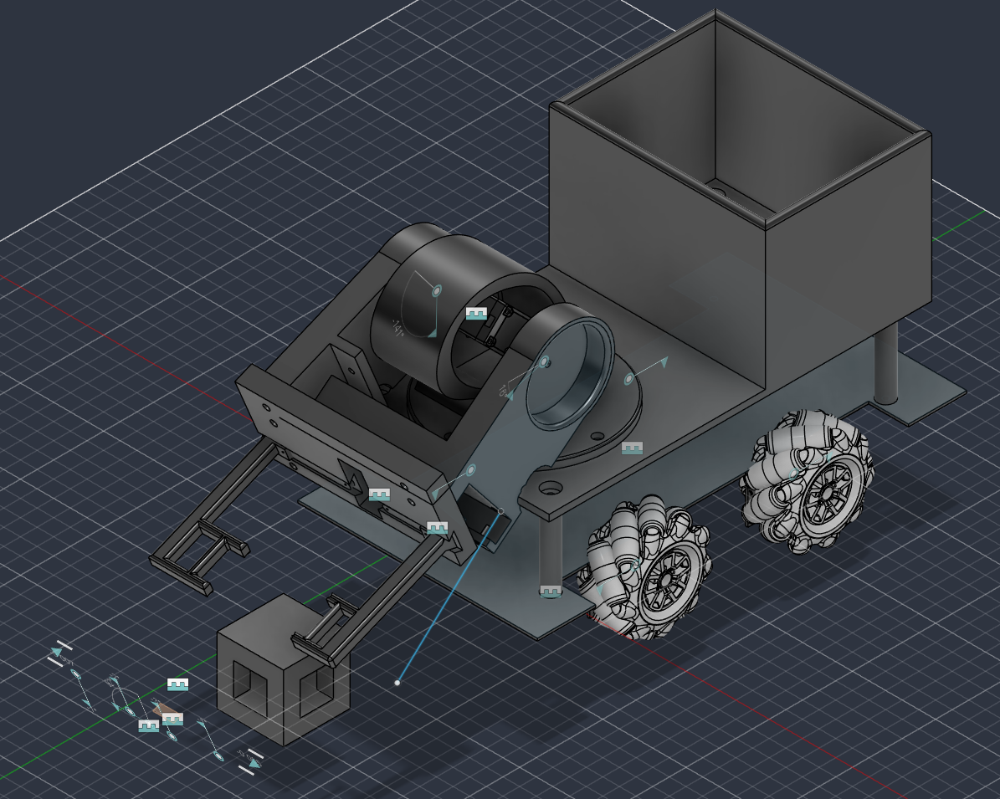


### 2.2 结构尺寸

本队采用**长方体包络**方式展示尺寸约束，三个方向均以卷尺贴车实测，测量照片见下。

| 项目 | 实测 / 预估 | 判据 | 测量方法 | 状态 |
| ---- | ---- | ---- | ---- | ---- |
| 整车初始尺寸（长×宽×高） | **260× 180 × 155 mm**（含裸露杜邦线，未接机械臂） | ≤ 290 × 195 × 210 mm | 卷尺贴车测外廓，机构收起 | 已实测（照片见下） |
| 展开最大尺寸（长×宽×高） | 350 × 165 × 290 mm（PCB + 完整机械臂） | ≤ 445 × 400 × 450 mm | 机构展开到极限后测量 | 预估，待实测 |
| 整机重量 | 不会超重 | ≤ 2.0 kg | 电子秤称含电池整机 | 待实测 |

**长度测量**（车尾至车头外廓，卷尺读数约 260 mm）：

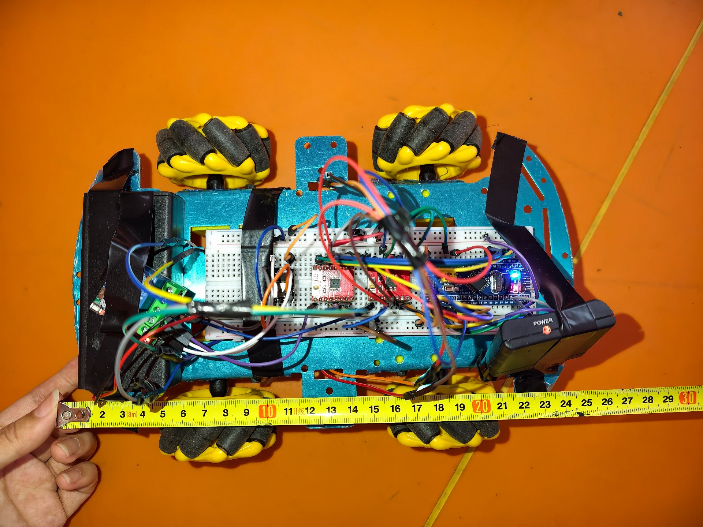

**宽度测量**（左右轮外缘，卷尺读数约 180 mm）：

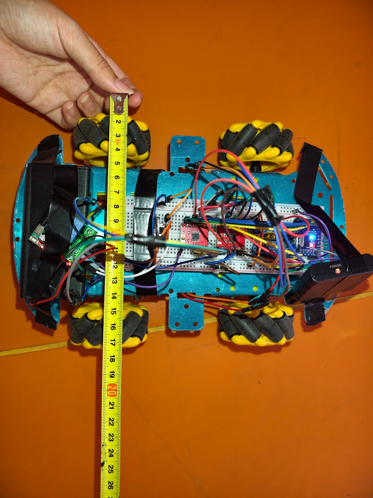

**高度测量**（地面至最高点，卷尺读数约 155 mm）：

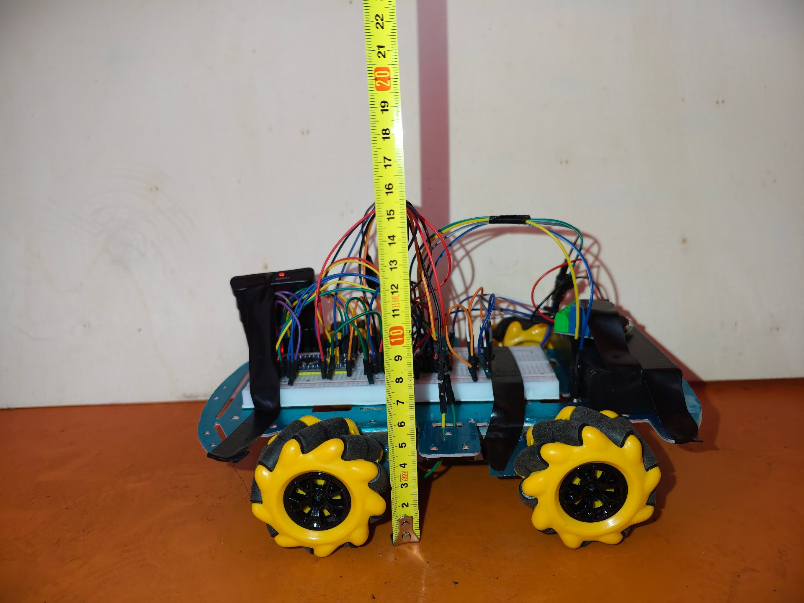


### 2.3 零件设计与加工

1. **Fusion360 建模**：整车按功能模块分层设计，包括底盘框架、舵机执行机构、方块储存仓、麦轮安装支架等。

   - 初始态：约 260 × 150 × 205 mm；
   - 展开态：约 350 × 150 × 290 mm。

   

   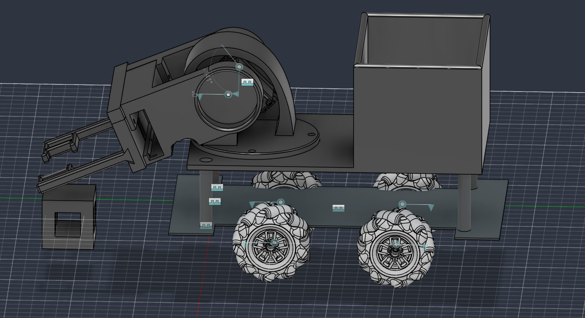

   > 装配体树截图待补：需截取 Fusion360 浏览器面板，展示零部件层级与约束关系。

2. **3D 打印 / 亚克力切割**：3D 打印件在京东找商家加工，材质为 PETG。

3. **装配过程**：目前尚未完成整机装配。

4. **机构想法演示**：

   - [舵机机构运动演示 1](../media/demo_servo_mechanism_1.mp4)
   - [舵机机构运动演示 2](../media/demo_servo_mechanism_2.mp4)

本队采用**金属折弯板底盘 + 3D 打印支架 + 螺丝紧固**的组合，结构件之间不使用热熔胶，符合手册 3.3.3 “避免采用热熔胶与其他物质的组合形式”的要求。


### 2.4 机械迭代记录

**V1：问题暴露**

- 初版没有采用标准件，孔位与舵机尺寸靠手工配作，零件互换性差，装配和返修都依赖同一套手工尺寸；
- 前端设计过短，舵机机构与前部支架在极限位置相互挤压，装配后前部空间不足以容纳完整执行机构。

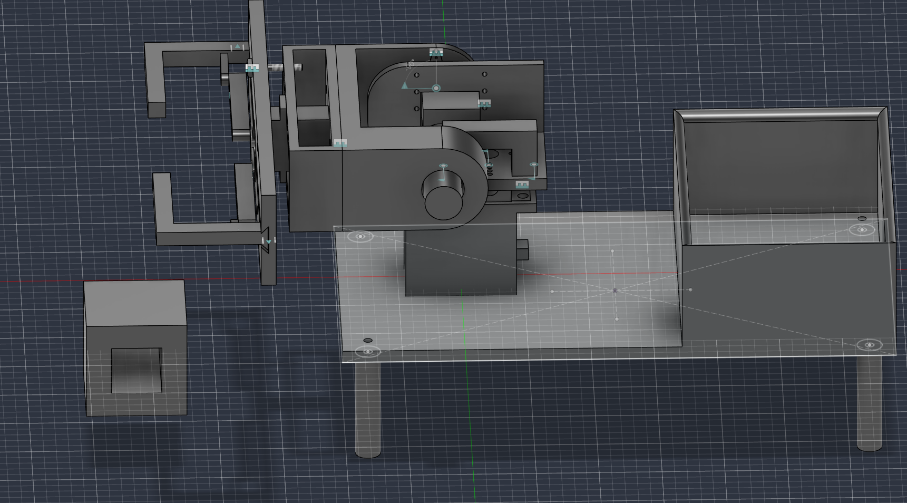

**V1 → V2：针对性改动**

针对上述两个问题，V2 不是简单“重画”，而是按因果逐项修改：

1. **先解决空间问题**：把舵机数量从 3 个减到 2 个，缩短前端执行链，直接消除“前端太短”造成的干涉；
2. **再解决互换性问题**：全面改用舵机标准件与标准孔位，减少手工配作，让支架、舵盘和紧固件可以单独更换；
3. **最后解决整体布局**：参考麦轮底盘的对称布局重新排布底盘、舵机支架与电池/PCB 安装位置，使四轮受力更均衡。


**V2：效果验证**

- 舵机数量减少 1 个，前端长度随之缩短，V1 的前部干涉被消除；
- 标准件与标准孔位使装配、更换和复装更快，不再依赖单件手工配作；
- 麦轮底盘布局让四轮与执行机构的安装基准统一，为后续四轮协同调试留出空间。

**遗留问题与下一步**

- V2 仍存在尺寸多次修改后的局部错误，当前先打印样件做装配验证，再根据实际干涉/孔位偏差继续修正；


### 2.5 结构稳定性测试

| 项目 | 内容 | 状态 |
| ---- | ---- | ---- |
| 跌落高度 | 180 mm（落在手册 150–200 mm 区间内） | 已完成 |
| 高度测量方式 | 直尺 / 卷尺固定在跌落位置旁，镜头内同框可见刻度 | 已完成 |
| 初始姿态 | 底面朝下、自由落体，不做倾斜或导向 | 已完成 |
| 跌落次数 | 2 次，视频展示第二次 | 已完成 |
| 有无零件掉出 | 无 | 已完成 |
| 加强措施 | 电池与 PCB 螺丝固定、接插件压紧、关键支架加厚 | 已完成 |

**测试结论**：两次跌落均正常，无零件掉出。


[跌落测试视频](../media/drop_test.mp4)


## 三、硬件设计

### 3.1 主控与外设选型

**主控选 STM32F103C8T6**：72 MHz Cortex-M3，64 KB Flash / 20 KB RAM，37 个 IO。以“蓝板”最小系统插在底板上，损坏可整板更换，资料与例程也更丰富。

| 外设 | 需求 | F103C8T6 上的分配 | 余量 |
| ---- | ---- | ---- | ---- |
| 电机 PWM | 4 电机 × 2 线 = 8 路 | TIM2（PA0–PA3，CH1–CH4）+ TIM1（PA8–PA11，CH1–CH4） | TIM3、TIM4 空闲 |
| 舵机 PWM | 3 路 50 Hz | TIM4 CH1–CH3（PB6 / PB7 / PB8） | TIM4 CH4 空闲 |
| PS2 通信 | 4 线（CS/CLK/DAT/CMD） | PB12 / PB13 / PB14 / PB15 软件模拟 SPI | 硬件 SPI1 未占用 |
| 状态指示 | 1 路 LED | PC13（低电平点亮） | — |

**电机驱动选 DRV8833**：单片双 H 桥、工作电压 2.75–10.8 V，与 7.4 V 电池组直接匹配；一片带 2 个电机，2 片覆盖 4 个 TT 电机。

| 驱动方案 | 供电范围 | 单板通道 | 单价 | 体积 / 发热 | 结论 |
| ---- | ---- | ---- | ---- | ---- | ---- |
| DRV8833 | 2.75–10.8 V | 2 路双 H 桥 | ¥2.27 | 体积小、SOT23 封装散热好 | ✅ 选用 |
| TB6612FNG | 2.7–5.5 V | 1 路 | 较高 | 需额外升压 | ✗ 电压不匹配 |
| L298N | 5–35 V | 2 路双 H 桥 | 较低 | 双排直插，发热大、压降约 1.8 V | ✗ 7.4 V 下压降占比过大 |
| BTS7960 | 大电流 | 1 路 | 高 | 体积大 | ✗ TT 电机不需要此电流等级 |

DRV8833 的持续输出电流对 TT 电机足够，但堵转余量不大，因此固件做了软件限速（±800），机械上也避免机构卡死造成长时间堵转。

**舵机供电**：单独一路 5 V 降压（`+5V-SERVO`），与主控 5 V（`+5V-STM32`）隔离。MG995 空载电流可达 100–200 mA、堵转接近 1 A，多舵机同时启动的冲击若与主控共用一路 5 V，会把主控拉低触发欠压复位，表现为“一动舵机就重启”。对比单路共用降压，双路独立在稳定性上明显更优。


!-- 冲 5 分建议：补 DRV8833 堵转电流与软件限速的定量关系（例如堵转电流、限速后占空比、温升），把“为什么限速到 800”讲实。 -->

### 3.2 电源方案

- **电池**：7.4 V 2S 锂电池经 XT30 输入；
- **保护**：正极串自恢复保险丝 H16-1000（位号 F1）后形成主电源 `VMAIN-7V4`；
- **降压**：两片 miniDC-DC（5–30 V 入 / 5 V 出），分别输出 `+5V-STM32`（主控 + PS2）与 `+5V-SERVO`（舵机）；
- **断电**：AG-C106 继电器 COM 口接保险丝后的 `+7.4V`、NO 口接 `VMAIN-7V4`，NC 悬空；作为官方无线继电器串入电池回路的接入点，实现 10 m 遥控断电；
- **储能 / 去耦**：100 nF ×4和 10uF ×4 集中于 `+5V-SERVO`，470 µF ×4 分布于各电源轨，100 nF ×4 旁路（分布在降压模块与 DRV8833 的 VM 脚）。

<!-- 数值核对：BOM 与 PCB 为 1000 µF ×4 舵机轨储能；本行现写 100 nF ×4 + 10 µF ×4，请确认最终实物配置后统一。 -->

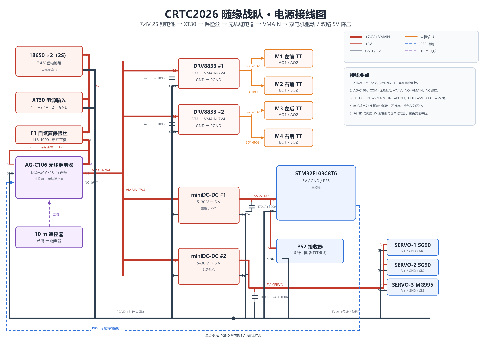

> 图注：XT30 输入 → F1 自恢复保险丝 → AG-C106（COM/NO）→ VMAIN；两路 miniDC-DC 分别输出 +5V-STM32 与 +5V-SERVO；PGND 与两路 5V 地在配电区单点汇合。红色为 +7.4V/VMAIN，细红为 +5V，黑色为 GND，橙色为电机 H 桥输出。

[PCB 原理图 PDF](../pcb/CRTC_copy_schematic.pdf)


### 3.3 硬件接线说明

**电机（8 路 PWM → 2 片 DRV8833）**

| 电机 | 位置 | PWM 引脚 | 定时器通道 | 驱动接口 |
| ---- | ---- | ---- | ---- | ---- |
| M1 | 左前 FL | PA0 / PA1 | TIM2_CH1 / CH2 | DRV8833 #1 IN1 / IN2 |
| M2 | 右前 FR | PA2 / PA3 | TIM2_CH3 / CH4 | DRV8833 #1 IN1 / IN2 |
| M3 | 左后 RL | PA8 / PA9 | TIM1_CH1 / CH2 | DRV8833 #2 IN1 / IN2 |
| M4 | 右后 RR | PA10 / PA11 | TIM1_CH3 / CH4 | DRV8833 #2 IN1 / IN2 |

STBY：D1 前轮驱动 STBY 接 PB10，D2 后轮驱动 STBY 接 PB11（mid_term_report 补充；GitHub 版未列，需与 PCB 实际网络复核）。

电机输出经 4 个 2 针母座引出：`1-AO1/1-AO2`、`1-BO1/1-BO2`、`2-AO1/2-AO2`、`2-BO1/2-BO2`。

**舵机（3 路，TIM4，50 Hz）**

| 舵机 | 型号 | 信号引脚 | 定时器通道 | 接口 |
| ---- | ---- | ---- | ---- | ---- |
| SERVO-1 | SG90 | PB6 | TIM4_CH1 | `GND` / `+5V-SERVO` / `SERVO-1` |
| SERVO-2 | SG90 | PB7 | TIM4_CH2 | `GND` / `+5V-SERVO` / `SERVO-2` |
| SERVO-3 | MG995 | PB8 | TIM4_CH3 | `GND` / `+5V-SERVO` / `SERVO-3` |
| SERVO-4 | 预留 | 待确认 | TIM4_CH4 | 预留给方块携带机构 |

**PS2 手柄接收器（4 线软件模拟 SPI）**：6 针排针，`CS`=PB12、`CLK`=PB13、`DAT`=PB14、`CMD`=PB15，另接 `+5V-STM32` 与 `GND`。

**其他**：无线继电器 PB5；状态 LED PC13（快闪 = 对频中，常亮 = 在线，灭 = 掉线）；STLink/SWD 调试口，SWDIO/SWCLK 对应板上焊盘，运行时断开 USB 数据线；BOOT0 拉低；PA11 用作电机 PWM，不可复用；PA15 不可替代 SWDIO/SWCLK。

> **接线以本节表格为准。** 整机接线示意图 `images/wiring.png` 尚未绘制，当前可参考 §3.2 的电源原理图 `images/power_sch.png` 与 §3.4 的 PCB 图对照实物接线。

### 3.4 PCB 与底板工艺

集成底板（自制 PCB）承载电源输入、保护、双路降压、电机驱动、继电器控制与全部接口。

| 项目 | 参数 | 
| ---- | ---- | 
| 设计工具 | 嘉立创 EDA 专业版 4.1.71（工程 `CRTC_copy`） |
| 层数 | 2 层（Top / Bottom） 
| 板框 | 175.0 mm × 92.0 mm，四角 R2.8 mm | 
| 板材 | FR-4 | 已确认
| 板厚 | 约 1.6 mm | 
| 铜厚 | 外层 1 oz |
| 表面处理 | 有铅喷漆
|  数量 | 5   
| 焊接方式 | 手工焊接（THT 插件与模块插座为主） | 
| 布局 | 电源 / 驱动 / 接口分区，整板铺地，大电流走线加宽 | 
| 选择理由 | 1.6 mm 标准板厚兼顾强度与成本；1 oz 铜厚配合加宽走线满足电机/舵机电流；双层板满足当前密度 | 

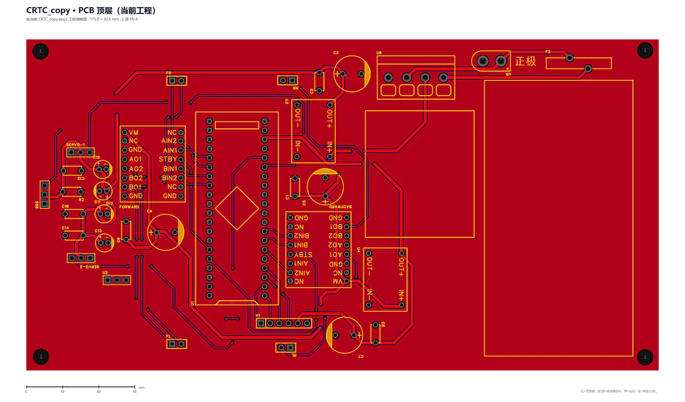

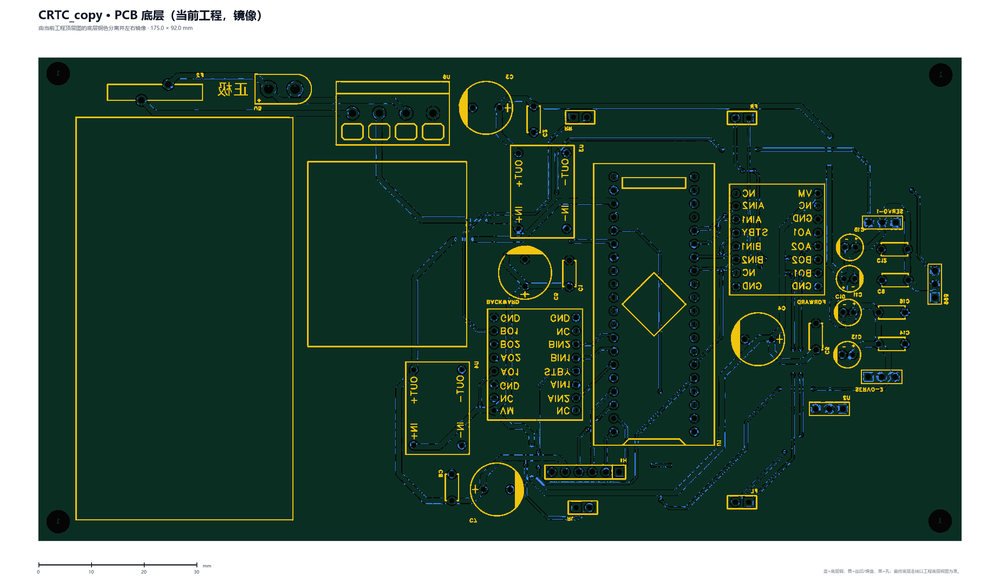

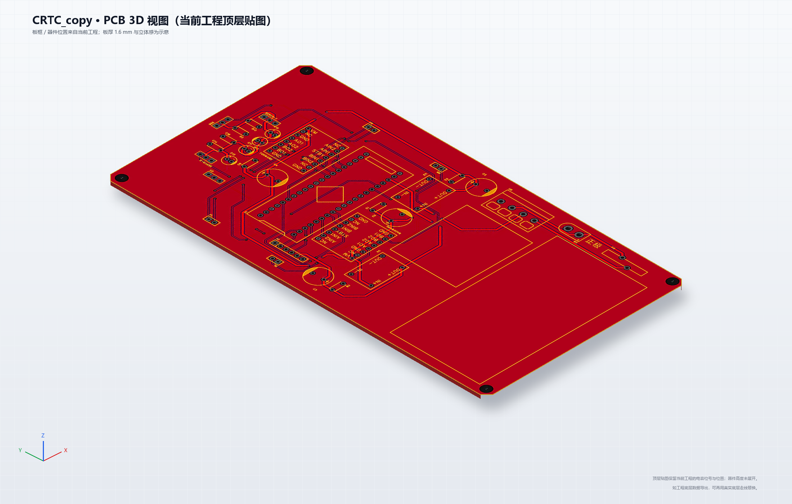

> 图注：顶层为当前工程布局（红=顶层铜，蓝/紫=底层铜透出）；底层由当前工程底层铜色分离并左右镜像；3D 为当前顶层贴图的等轴测示意。板框 175.0 × 92.0 mm，双层 FR-4；底层与 3D 为缩略图衍生视图，最终以工程导出为准。


### 3.5 硬件调试遇到的问题与解决

| # | 现象 | 原因分析 | 解决措施 |
| - | ---- | ---- | ---- |
| 1 | 四轮同时控制时，有一个轮子只能正转、不能反转 | 电机本体故障 | 先排除软件，再按“电源→降压→驱动→电机”用万用表逐级测量，借同组已调好的小车交叉验证，最终更换电机解决 |
| 2 | 主控电源灯与 PS2 配对灯异常闪烁，手柄无法对频 | 7.4 V 与 5 V 共地串扰 | 将两路地分开：输入 5 V 的模块接 5 V 地，输入 7.4 V 的模块接 7.4 V 地，故障消除 |
| 3 | 继电器断电后仍有一个轮子全速旋转，只能关电池盒 | STM32 与驱动 IN 引脚接触不良，电源绕过控制直接驱动电机 | 沿功率回路逐点测电压定位，压紧并补焊该连接后恢复 |
| 4 | 摇杆归位后小车滑行一段才停，直行时走曲线 | 更换电机后麦克纳姆轮未按 X 型（正反交错）安装 | 重新按 X 型安装，滑行与走偏消除 |

> 除上述典型问题外，备赛期间还积累了大量接线、虚焊、参数整定等小问题，均已逐一记录并修复，此处不一一展开。


### 3.6 近期调试时间线（2026-10-15 ~ 10-18）

| 日期 | 模块 | 做了什么 | 踩到的坑 / 结论 |
| ---- | ---- | ---- | ---- |
| 10-15 | 工程搭建 | CubeMX 建工程：TIM1/TIM2 输出 20 kHz 电机 PWM，TIM4 输出 50 Hz 舵机 PWM | 72 MHz / 72 = 1 MHz（1 格 = 1 µs），ARR=20000 才是 20 ms / 50 Hz |
| 10-15 | 舵机 | 写 `servo.c`：角度→脉宽线性映射（0°=500 µs，180°=2500 µs） | 三路舵机上电必须全部回中 90°，否则一上电就往一侧打死 |
| 10-17 | PS2 | 写 `ps2.c`：GPIO 软件模拟 SPI，用 DWT 计数器做 µs 级延时 | 山寨接收器时序慢，`delay_us(4)` 不够就得加大；配置命令之间要留间隔 |
| 10-17 | PS2 | 加脏帧过滤：丢弃握手字节≠0x5A、ID 非 0x73/0x41、四摇杆同时为端点值的帧 | 不滤脏帧时，手柄掉线后整车会“记住”最后一次摇杆值继续冲 |
| 10-17 | 电机 | 写 `motor.c`：DRV8833 两线控制 + 麦轮逆运动学 | 叠加后可能超 ±1000，必须整体等比归一化 |
| 10-18 | 安全逻辑 | 改 `main.c`：START 解锁加“R1 松开 + 四摇杆归中”；R1 按住才走；R2 精细档；掉线重新上锁 | 原逻辑掉线后 `unlocked` 不清零，恢复连接会瞬间冲出 |
| 10-18 | 调试工具 | 新增 `debug_servo` / `debug_motor` / `debug_ps2`，用 `DEBUG_MODE` 宏切换 | 板子只有 PC13 LED 且无串口，只能靠闪烁节奏编码状态 |
| 10-18 | 仓库整理 | 清理 Debug 编译产物与 IDE 用户配置，整理仓库结构 | 现有两段演示视频是 720p，不达 1080p，正式考核视频需重录 |

## 四、软件整体架构

### 4.1 开发环境

| 项目 | 配置 |
| ---- | ---- |
| MCU | STM32F103C8T6，72 MHz（HSE 8 MHz + PLL×9），APB1 36 MHz / APB2 72 MHz |
| IDE | STM32CubeMX + STM32CubeIDE（另含 EWARM 工程） |
| 固件库 | STM32 HAL 库（F1 系列） |
| 工具链 | ARM GCC / IAR EWARM |
| RTOS | 未使用，裸机 + 主循环轮询，约 66 Hz（15 ms 周期） |

### 4.2 软件模块划分

| 模块 | 文件 | 职责 |
| ---- | ---- | ---- |
| PS2 手柄接收 | `ps2.c` / `ps2.h` | GPIO 软件模拟 SPI，对频配置，按键与摇杆解析 |
| PWM 电机输出 | `motor.c` / `motor.h` | TIM1/TIM2 八路 PWM，DRV8833 两线控制 |
| 麦轮运动解算 | `motor.c` 内 `Motor_Drive()` | 逆运动学 + 超量程归一化 |
| 舵机控制 | `servo.c` / `servo.h` | TIM4 三路 50 Hz PWM，角度→脉宽映射 |
| 主循环与安全逻辑 | `main.c` | 输入处理、锁定/解锁、掉线停车、继电器控制 |
| 硬件初始化 | `tim.c` / `gpio.c` / `stm32f1xx_hal_msp.c` | CubeMX 生成 |
| 调试模式 | `debug_config.h` + `debug_*.c` | `DEBUG_MODE` 宏切换舵机/电机/PS2 独立调试 |

软件数据流：

```
PS2_Poll() → buttons / lx,ly,rx,ry
              │
   ┌──────────┼──────────┐
   ↓          ↓          ↓
安全锁定    麦轮解算    舵机角度
SELECT/START Motor_Drive Servo_SetAngle×3
   ↓          ↓          ↓
R1/R2 门控  逆运动学    限幅 0~180°
   ↓          ↓          ↓
        __HAL_TIM_SET_COMPARE() → TIM1/TIM2/TIM4
```

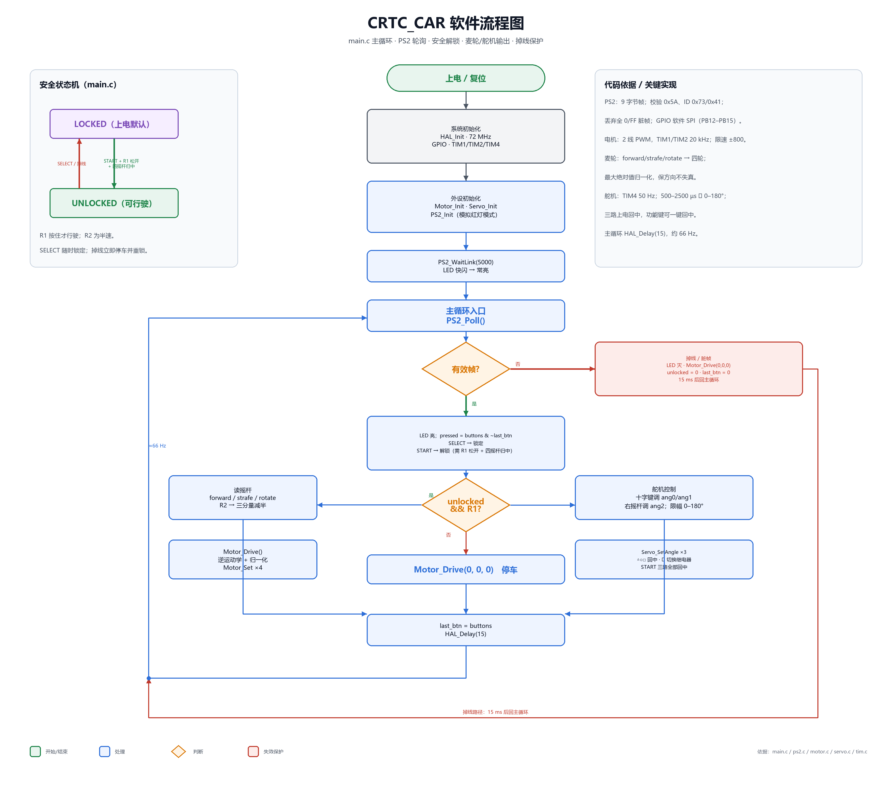

> 图注：上电初始化 → PS2 轮询 → 有效帧判断 → 安全锁定/解锁 → R1 行驶 → 麦轮/舵机输出；掉线/脏帧立即停车并重新上锁；主循环约 66 Hz。

### 4.3 主循环时序与安全逻辑

主循环周期 `HAL_Delay(15)`，约 66 Hz，给 PS2 轮询留出余量。

- 上电默认锁定，底盘不动；
- SELECT 随时锁定；
- START 仅在“未锁定 + R1 已松开 + 四摇杆全部归中”时解锁；
- R1 按住才行驶，松开立即停车；R2 为精细档（三个分量减半）；
- 手柄掉线时立即 `Motor_Drive(0,0,0)` 并重新上锁，清空按键存档，防止重连后误触发。

### 4.4 关键代码

**单电机调速**（`firmware/CRTC_CAR/Core/Src/motor.c`）

```c
#define MOTOR_SPEED_MAX 1000   /* speed 满量程 */
#define MOTOR_PWM_FULL  3600   /* ARR=3599，占空比满值 */
#define MOTOR_MAX_SPEED 800    /* 软件限速 */

void Motor_Set(uint8_t motor, int16_t speed)
{
    if (motor >= MOTOR_NUM) return;
    if (speed >  MOTOR_MAX_SPEED) speed =  MOTOR_MAX_SPEED;
    if (speed < -MOTOR_MAX_SPEED) speed = -MOTOR_MAX_SPEED;

    uint32_t duty = (uint32_t)((speed >= 0) ? speed : -(int32_t)speed)
                    * MOTOR_PWM_FULL / MOTOR_SPEED_MAX;

    if (speed > 0) {                       /* 正转：IN1=PWM, IN2=0 */
        __HAL_TIM_SET_COMPARE(motors[motor].htim, motors[motor].ch1, duty);
        __HAL_TIM_SET_COMPARE(motors[motor].htim, motors[motor].ch2, 0);
    } else if (speed < 0) {                /* 反转：IN1=0, IN2=PWM */
        __HAL_TIM_SET_COMPARE(motors[motor].htim, motors[motor].ch1, 0);
        __HAL_TIM_SET_COMPARE(motors[motor].htim, motors[motor].ch2, duty);
    } else {                               /* 滑行 */
        __HAL_TIM_SET_COMPARE(motors[motor].htim, motors[motor].ch1, 0);
        __HAL_TIM_SET_COMPARE(motors[motor].htim, motors[motor].ch2, 0);
    }
}
```

**麦轮逆运动学 + 归一化**（`motor.c`）

```c
void Motor_Drive(int16_t forward, int16_t strafe, int16_t rotate)
{
    int32_t v[MOTOR_NUM];
    v[MOTOR_FL] = (int32_t)forward + strafe + rotate;
    v[MOTOR_RF] = (int32_t)forward - strafe - rotate;
    v[MOTOR_RL] = (int32_t)forward - strafe + rotate;
    v[MOTOR_RR] = (int32_t)forward + strafe - rotate;

    int32_t maxabs = 1;
    for (int i = 0; i < MOTOR_NUM; i++) {
        int32_t a = (v[i] >= 0) ? v[i] : -v[i];
        if (a > maxabs) maxabs = a;
    }
    for (int i = 0; i < MOTOR_NUM; i++) {
        int32_t out = (maxabs > MOTOR_SPEED_MAX)
                    ? (v[i] * MOTOR_SPEED_MAX / maxabs) : v[i];
        Motor_Set((uint8_t)i, (int16_t)out);
    }
}
```

> **第五章 · 基础功能实现**
>
> 本章按手册 4.1.2 的 12 项考核指标逐项成板块，每项以功能名称为 H2 标题，正文包含功能描述、实现方式与开发历程。

## 5.1 外形展示

**考核要求**（手册 4.1.2 第 1 项）：至少有一台**携带能量单元**的完整机器人机体，需**绕车一周**展示整车外形。

**需要书写的内容**：

- 整机外观设计说明（造型、配色、标识）；
- “绕车一周”的拍摄路径（建议地面贴一圈胶带标出路线，俯视 + 平视各一）；
- 能量单元的固定方式（车上需实际放置 / 固定一颗 30×30×30 mm 的白色立方体）。

**展示方式**：绕车一周的连续视频，车体上装有能量单元。

[整车外形展示（绕车一周）](../media/appearance_360.mp4)

> 规格：1584×720 / 25 fps / 10.0 s。

**状态**：已实现。


## 5.2 电机运动（单一电机）

**考核要求**：至少完成一个电机的转动。

每个电机用 2 根 PWM 线接 DRV8833 的 IN1 / IN2：

| IN1 | IN2 | 电机状态 |
| ---- | ---- | ---- |
| PWM | 0 | 正转 |
| 0 | PWM | 反转 |
| 0 | 0 | 滑行停车 |
| 1 | 1 | 刹车（未使用） |

2 线控制省掉 4 路使能 IO，且滑行态就是两线全 0，停车逻辑与“无输出”天然一致。

TIM1 / TIM2 均为 Prescaler=0、Period=3599，PWM 频率 = 72 MHz / 3600 = **20 kHz**，高于人耳听觉上限，避免啸叫。速度满量程 ±1000 → 占空比 0–3600，软件限速 ±800。

**展示方式**：视频展示至少一个电机转动，建议同时给正转 / 反转 / 停止三个状态。

**状态**：已实现。


## 5.3 电机运动（全部电机）

**考核要求**：能完成不少于 4 个电机的转动。

2 片 DRV8833 各带 2 个电机，共 4 路；TIM2（PA0–PA3）与 TIM1（PA8–PA11）共 8 路 PWM 对应 4 个麦轮电机。固件用资源表固化“电机编号 → 定时器 + 通道”，新增电机只改表：

```c
typedef struct {
    TIM_HandleTypeDef *htim;
    uint32_t ch1, ch2;
} Motor_t;

static const Motor_t motors[MOTOR_NUM] = {
    { &htim2, TIM_CHANNEL_1, TIM_CHANNEL_2 },   /* FL: PA0/PA1 */
    { &htim2, TIM_CHANNEL_3, TIM_CHANNEL_4 },   /* FR: PA2/PA3 */
    { &htim1, TIM_CHANNEL_1, TIM_CHANNEL_2 },   /* RL: PA8/PA9 */
    { &htim1, TIM_CHANNEL_3, TIM_CHANNEL_4 },   /* RR: PA10/PA11 */
};
```

**展示方式**：视频展示 4 个电机同时转动（底盘悬空或抬起，四轮同时可见）。


**状态**：已实现。

## 5.4 舵机运动（单一舵机）

**考核要求**：至少完成一个舵机的转动。

舵机挂 TIM4：Prescaler=71、Period=19999。TIM4 位于 APB1（PCLK1=36 MHz），定时器时钟倍频到 72 MHz，故 1 个计数 = 1 µs，周期 20 ms → **50 Hz**。脉宽 500–2500 µs 对应 0–180°。

```c
uint32_t pulse = PULSE_MIN_US
    + (uint32_t)(angle * ((PULSE_MAX_US - PULSE_MIN_US) / 180.0f));
__HAL_TIM_SET_COMPARE(&htim4, servo_ch[id], pulse);
```

用硬件 PWM 而不是软件延时翻转：手柄轮询 15 ms，软件定时会与主循环耦合；硬件 PWM 由定时器独立计数，脉宽稳定在 ±1 µs，也是“多项舵机保持静止”的硬件基础。

**展示方式**：视频展示至少一个舵机转动。

[舵机运动演示](../media/servo_demo.mp4)

> 规格：1584×720 / 25 fps / 14.9 s。与 5.5 共用同一段素材。

**状态**：已实现。

## 5.5 舵机运动（多项舵机）

**考核要求**：同一台机器人至少 3 个舵机转动，并确保可动机构在任意非初始状态保持相对静止。

底板预留 4 路舵机接口，固件当前启用 3 路：

| 舵机 | 型号 | 引脚 | 定时器 | 控制方式 |
| ---- | ---- | ---- | ---- | ---- |
| SERVO-1 | SG90 | PB6 | TIM4_CH1 | 十字键 ↑/↓，每帧 2° 步进 |
| SERVO-2 | SG90 | PB7 | TIM4_CH2 | 十字键 →/←，每帧 2° 步进 |
| SERVO-3 | MG995 | PB8 | TIM4_CH3 | 右摇杆上下连续调节 |
| SERVO-4 | 预留 | 待确认 | TIM4_CH4 | 方块携带机构 |

**“保持相对静止”的保证**：

1. 硬件：TIM4 持续输出，脉宽误差 ±1 µs，角分辨率约 0.1°；
2. 控制：只在检测到输入时改写 CCR，输入停止后当前值被硬件锁定；
3. 扭矩：MG995 堵转扭矩约 9–11 kg·cm，SG90 约 1.8 kg·cm，机构负载需低于堵转扭矩才不会抖动找角度。

**展示方式**：视频展示 3 个舵机转动后，在非初始角度停顿保持（建议 ≥3 秒）。

[三舵机运动与保持演示](../media/servo_demo.mp4)

> 规格：1584×720 / 25 fps / 14.9 s。与 5.4 共用同一段素材。

**状态**：已实现（扭矩数据待补）。

<!-- 冲 5 分建议：补机构等效负载与舵机扭矩的对比表，这是“保持静止”最有力的论证；只拍转动会丢掉一半得分点。 -->

## 5.6 底盘运动（单一底盘）

**考核要求**：使用 PS2 手柄控制至少一个底盘的水平运动，需保证车体与 PS2 手柄同时出镜或给出相关代码。

PS2 接收器直插 6 针排针，`CS`=PB12、`CLK`=PB13、`DAT`=PB14、`CMD`=PB15，4 根 GPIO 软件模拟 SPI；上电进入“模拟红灯模式”，`PS2_WaitLink(5000)` 最多等 5 s 对频。

摇杆映射：

| 输入 | 运动分量 |
| ---- | ---- |
| 左摇杆 ↑/↓ | 前进 / 后退（forward） |
| 左摇杆 ←/→ | 左右平移（strafe） |
| 右摇杆 ←/→ | 原地旋转（rotate） |
| R1 按住 | 行驶（否则停车） |
| R2 | 精细档，三分量减半 |
| 死区 | ±12 |

死区 ±12 约对应 9.4% 满量程，在“轻推就能动”和“静止不自漂”之间取平衡；死区外线性映射 `x * 1000 / 128`。

麦轮逆运动学把 3 个车体分量解算为 4 个轮速：

| 运动分量 | 左前 FL | 右前 FR | 左后 RL | 右后 RR |
| ---- | ---- | ---- | ---- | ---- |
| 前进 +1 | +1 | +1 | +1 | +1 |
| 右移 +1 | +1 | −1 | −1 | +1 |
| 顺时针 +1 | +1 | −1 | +1 | −1 |

三个分量叠加后单轮可能达到 3 倍满量程，固件按最大绝对值整体等比缩放，保住方向不变形；代价是合成运动速度降低，但赛场以单一运动为主，取舍合理。

**展示方式**：车体与 PS2 手柄必须同框，依次展示前进 / 后退 / 左右平移 / 原地旋转，最好再演示一次合成运动。

[PS2 底盘运动演示](../media/chassis_ps2.mp4)

> 规格：1920×1080 / 30 fps / 12.8 s。车体与 PS2 手柄同框，依次演示前进、后退、左右平移、原地旋转。

**状态**：已实现（1 台完整底盘）。

<!-- 冲 5 分建议：一个视频内同时拍到手柄操作与车体响应；四轮尽量可见，避免只拍车头造成“是否全部轮子都在动”的争议。 -->

## 5.7 底盘运动（全部底盘）

**考核要求**：使用 PS2 手柄控制全部车体的水平运动。

**状态**：未实现。

**原因**：初期损耗太大，剩下完好的模块不足以支持第二辆完整底盘的组装；当前只有一台完整底盘，因此“全部车体”无法展示。

5.6 的固件与 PCB 方案可直接复用到第二台底盘；若后续补齐第二台，只需按同一接线与同一固件装配即可。

<!-- 冲 5 分建议：如实标注未实现，不要用“1 台车已实现”混淆“全部车体”；若后续补第二台，补拍两台车同时受控的视频。 -->
<!-- 重要：按 V1.6 4.1.1，进阶功能必须在全部基础功能完成后才计分；5.7 未实现会直接导致 5.13 的加分项目前不生效。 -->

## 5.8 尺寸规范

**考核要求**：机器人尺寸在规则限制内（初始 ≤290×195×210 mm；展开 ≤445×400×450 mm；重量 ≤2.0 kg）；需展示直尺等测量工具的测量结果。

本队采用**长方体包络**证明。

| 项目 | 数值 | 判据 | 状态 |
| ---- | ---- | ---- | ---- |
| 整车初始尺寸 | **260 ×180× 155 mm** | ≤290×195×210 mm | 已实测（卷尺照片见下） |
| 展开最大尺寸 | 350 × 165 × 290 mm | ≤445×400×450 mm | 预估，待实测 |
| 整机重量 | 待实测（预估不超重） | ≤2.0 kg | 待实测 |
| 自制底板 | 175.0 × 92.0 mm | — | 已确认 |

**展示方式**：直尺 / 卷尺测量照片，画面同时可见卷尺刻度与车体被测部位。

| 长度（约260 mm） | 宽度（约180 mm） | 高度（约 155 mm） |
| --- | --- | --- |
|  |  |  |


## 5.9 方块携带（单一）

**考核要求**：至少一台机器人自主使地面静止的 30×30×30 mm 方块由非携带态变为携带态。

**携带思路**：采用前置铲板 + 挡边浅仓。底盘前进时铲板把方块推入仓内，挡边限制侧向掉落；第 4 路舵机（TIM4_CH4）可用于抬升挡板或辅助夹持。

**未完成原因**：3D 打印工期长，还未产出实物机械臂，因此暂无可演示的携带动作。

**状态**：未完成。


## 5.10 方块携带（多项）

**考核要求**：在保持第一块方块携带状态的同时，再使至少一块地面静止方块由非携带态变为携带态。

**携带思路**：浅仓容量按 ≥2 块设计，先推入第一块并保持，再推入第二块；仓体宽度方向做斜挡，防止第一块在第二次收集时被挤落。

**未完成原因**：与 5.9 同一机构，3D 打印工期长，实物机械臂尚未产出。

**状态**：未完成。


## 5.11 结构稳定性测试

**考核要求**：机器人从 180 mm 高处、底面朝下的初始姿态自由下落，无零件掉出，需展示直尺测量结果。

**测试结果**：180 mm 高度、跌落 2 次，两次均正常，无零件掉出；测试车与其他指标展示车一致。

**展示方式**：直尺测量高度的照片 + 跌落过程视频（视频展示第二次跌落）。


[跌落测试视频](../media/drop_test.mp4)

> 规格：2560×1440 / 120 fps / 20.9 s（慢动作拍摄）。画面为 180 mm 高度自由落体的第二次跌落，落地面朝下。

**状态**：已完成。


## 5.12 规划 / 现有采购单（成本）

**考核要求**：队伍核心部件的选型、整机的成本预算。

| 核心部件 | 选型 | 核心理由 |
| ---- | ---- | ---- |
| 底盘 | 四轮麦克纳姆轮 | 全向运动、无需转向，把 3 路舵机留给执行机构；详见 2.1 |
| 主控 | STM32F103C8T6 | 官方指定核心板（¥9.40），PWM 资源刚好够用，最小系统可插拔更换 |
| 电机驱动 | DRV8833 ×2 | 2.75–10.8 V 直接匹配 7.4 V，单价 ¥2.27，体积与发热优于 L298N |
| 舵机供电 | 独立 5 V 降压 | 隔离舵机电流冲击，避免主控复位；见 3.1、3.5 |
| 布线 | 自制集成底板 | 手册 3.3.3 建议采用集成电路板，杜邦线易脱落 |
| 电源 | 2S 18650 + 自恢复保险丝 | 手册指定 18650；保险丝防止舵机堵转烧穿电池 |
| 遥控 | 官方 PS2 手柄 | 官方物资表指定款，降低失控风险 |

**成本预算**：按 1.4 的 A 类小计，已列单价项合计 **185.2 元**（不含保险丝、3D 打印与忽略不计项）；补齐后预计仍低于新生组 400 元上限。

**状态**：已完成


## 5.13 进阶功能（选做）

**本队加分项**：自制 PCB——原理图 + 布线完成的完整工程（`CRTC_copy`）。

### 5.13.1 迭代记录

- **V1 问题**：初版布局中电源与驱动未充分分区，单路降压稳定性不够，大电流走线偏细，接口分散，缺少电解电容和保险丝等加强稳定性的器件。
- **改进措施**：电源与信号分区；双路 5 V 独立降压；5v与7.4v地线分开；电机/舵机大电流走线加宽；整板铺地；接口模块化（XT30、KF127S、PS2、舵机、电机母座）。
- **V2 效果**：完成 175.0×92.0 mm 双层板布线，DRC 通过，打样后上车运行，四电机、三舵机、PS2 遥控均正常。


### 5.13.2 素材链接

- [完整 PCB 工程（.eprj2）](../pcb/CRTC_copy.eprj2)
- [原理图 PDF](../pcb/CRTC_copy_schematic.pdf)
- 
- 
- 
- [PCB 演示视频](../media/pcb_demo.mp4)


## 六、进阶与附加说明

### 6.1 开源项目与参考资料

手册 3.3 / 4.3.1 要求：将开源项目用于机器人制作或代码编写时，须在文档末尾完整说明并遵守开源协议。本队仅 PS2 手柄通信实现参照公开资料独立完成，未直接复制第三方开源代码。

| 项目 | 出处 | 用途 | 协议 / 许可 | 说明 |
| ---- | ---- | ---- | ---- | ---- |
| PS2 手柄通信实现 | 本队自研（`ps2.c`），参照公开的 PS2 控制器 SPI 时序资料 | 手柄通信 | 本队代码 | 非直接复制开源项目，依据公开协议文档独立实现 |
